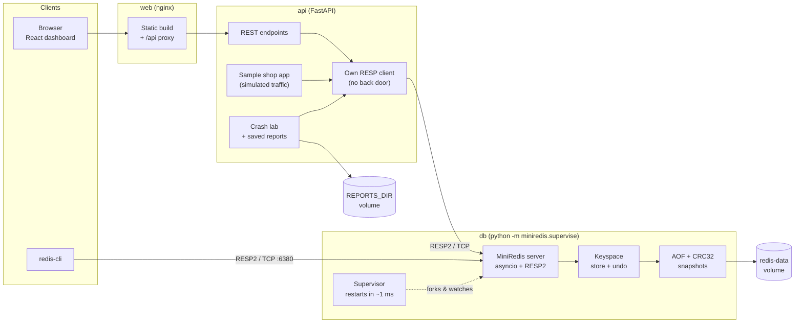
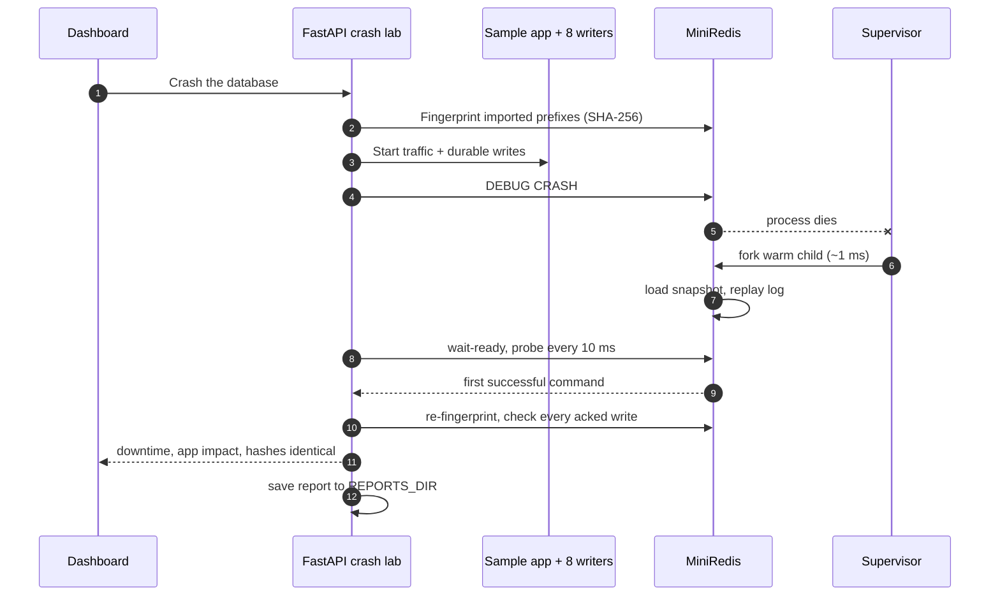
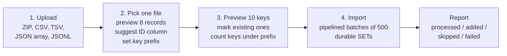
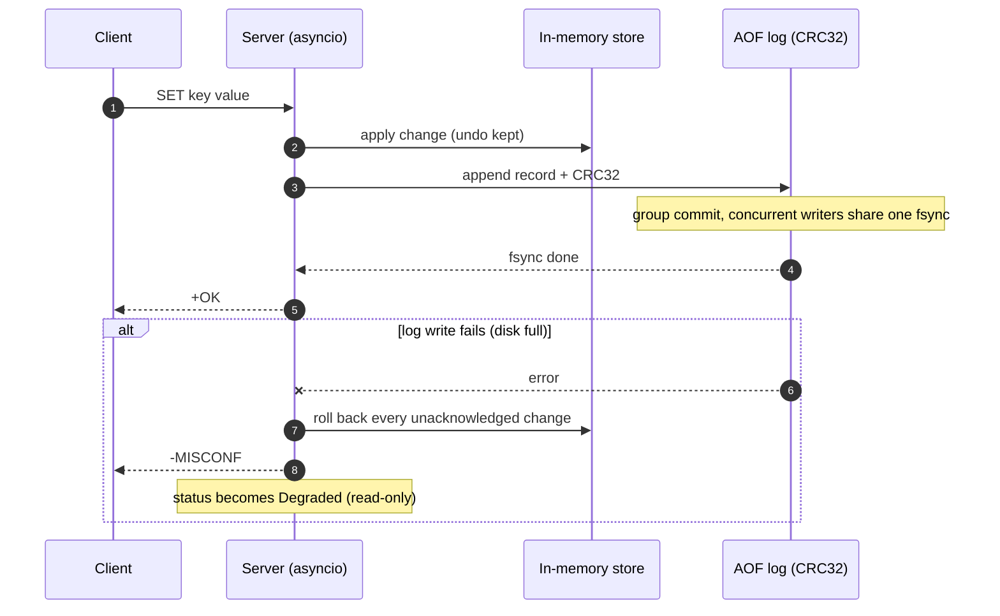
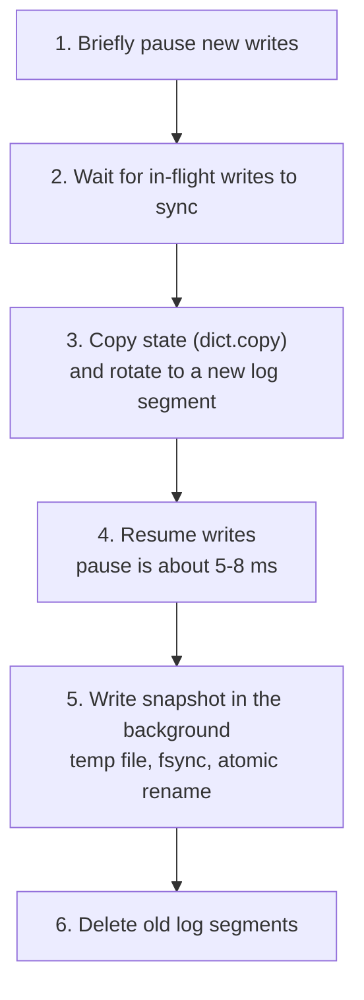
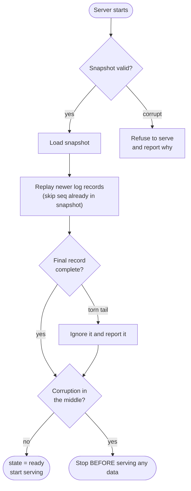

<div align="center">



<br/>

**A persistent, Redis-style key-value server written from scratch in Python `asyncio`, with a FastAPI bridge and a developer-console React dashboard.**

<br/>


[Quick start](#-quick-start) ·
[Dashboard](#-the-dashboard) ·
[Datasets](#-sample-datasets) ·
[Durability](#-durability-model) ·
[Benchmarks](#-benchmarks) ·
[Commands](#-supported-commands) ·
[Tests](#-tests)

</div>

<br/>

<div align="center">
  
</div>

<br/>

## ✨ Highlights

| | |
|---|---|
| 🔌 **A real database server** | Speaks **RESP2 over TCP**, so the stock `redis-cli` works against it. |
| 💾 **Durable by default** | Writes go to an **append-only log with CRC32 checksums** and are **fsynced before the client gets `OK`**. Snapshots and log rotation keep restarts fast. |
| 🛟 **Crash-safe recovery** | On startup it loads the snapshot and replays newer log records. An incomplete final record is ignored and reported. Corruption in the middle of the log stops the server **before** it serves any data. |
| ⏳ **Expirations survive restarts** | Deadlines are stored as **absolute timestamps**, so a restart never resets a key's lifetime. |
| 📊 **Observable** | A dashboard with Overview, Keys, Console and Durability views, plus a **chaos lab** that crashes the server and verifies what survived. |
| 🧪 **Heavily tested** | 51 server tests (including `kill -9` during concurrent writes and crashes inside a snapshot) and API integration tests against a real database process. |

<div align="center"></div>

## 🏗 Architecture



> The API talks to the database through its **own RESP client**, exactly like any other client. The dashboard has no privileged back door into the engine. In Docker Compose the database port is never published.

<div align="center"></div>

## 🧰 Tech stack

| Layer | Technology | Role |
|---|---|---|
| **Database engine** | Python 3.11+ · `asyncio` | RESP2 protocol, keyspace, expiry, group commit, snapshots, recovery (`server/miniredis/`) |
| **Persistence** | Append-only log · CRC32 · atomic snapshots | Durability and crash-safe recovery |
| **Supervisor** | In-container fork supervisor | Restarts a crashed server in about 1 ms, with crash-loop back-off |
| **Dashboard API** | FastAPI | Auth, key explorer, console, crash lab, dataset import, sample app, saved reports (`api/app/`) |
| **Frontend** | React 19 · Vite · TypeScript · Tailwind v4 · Motion | The dashboard (`web/`) |
| **Serving** | Nginx (optional Caddy for HTTPS) | Static build, `/api` proxy, automatic Let's Encrypt |
| **Packaging** | Docker Compose | `db` + `api` + `web`, with `private` and `demo` profiles |
| **Testing & CI** | pytest · GitHub Actions | Server and API suites, web build, image build and smoke test |
| **Tooling** | Bash · Python scripts | Benchmarks, backup, restore and verified restore (`scripts/`) |

<div align="center"></div>

## 🚀 Quick start

### Prerequisites

| Tool | Version | Needed for |
|---|---|---|
| Python | 3.11+ | database and API |
| Node.js | 20+ | dashboard |
| `redis-cli` | any (optional) | talking to the server directly |
| Docker + Compose v2 | optional | the one-command deploy |

### Option A: run locally (no Docker)

Clone the repo first:

```bash
git clone https://github.com/LoganthP/MiniRedis.git
cd MiniRedis
```

Install dependencies (one time):

```bash
pip install -r api/requirements-dev.txt -r server/requirements-dev.txt
cd web && npm install && cd ..
```

Then start the three processes, each in its own terminal:

| Terminal | Command | Serves |
|---|---|---|
| **1: database** | `scripts/run-db.sh` | MiniRedis on **:6380** (auto-restarts after a crash, `Ctrl+C` stops) |
| **2: API** | `DASHBOARD_PASSWORD=admin scripts/run-api.sh` | FastAPI on **:8000** |
| **3: dashboard** | `cd web && npm run dev` | React dev server on **http://localhost:5173** |

Open **http://localhost:5173**, sign in with `admin`, then click **Sample data**.

> The password defaults to `admin` for local use. If `DASHBOARD_PASSWORD` is empty, writes are open, so only do that for local development.

### Option B: Docker Compose (Linux VPS or your PC)

```bash
scripts/deploy.sh --profile private     # your own data (default)
# or
scripts/deploy.sh --profile demo        # disposable demo with sample data + chaos lab

scripts/smoke-test.sh                   # replace the db container, verify data + deadline survive
```

The dashboard is then at **http://localhost:8081** (`WEB_PORT`).

<details>
<summary><b>What <code>deploy.sh</code> does</b></summary>

1. Checks that Docker and Compose v2 are installed.
2. Creates `.env` from `deploy/<profile>.env`, generating random `DASHBOARD_PASSWORD`, `SESSION_SECRET` and `DB_PASSWORD`.
3. Runs `docker compose up -d --build`.
4. Waits for the database to report `ready` and for the dashboard to answer.
5. Prints the URL.

</details>

| Profile | Use for | Settings |
|---|---|---|
| `private` | your own data | `PUBLIC_READS=false`, `ALLOW_CRASH_DEMO=false`, database password set, web port bound to `127.0.0.1` (put HTTPS in front, or set `WEB_BIND=0.0.0.0`) |
| `demo` | a disposable portfolio instance | `PUBLIC_READS=true`, crash lab on, web port exposed |

**HTTPS.** Point DNS at the server, set `DOMAIN=miniredis.example.com` in `.env`, then run:

```bash
scripts/deploy.sh --https
```

That adds Caddy with automatic Let's Encrypt certificates on ports 80 and 443.

### Talk to it with `redis-cli`

```bash
redis-cli -p 6380 SET greeting "hello" EX 120
redis-cli -p 6380 TTL greeting
redis-cli -p 6380 --scan --pattern 'demo:*'
```

No `redis-cli`? Use the bundled client:

```bash
cd server && python -m miniredis.cli SET greeting hello
```

With Docker Compose the database port is not reachable from your machine, so run the CLI inside the container:

```bash
docker compose exec db python -m miniredis.cli SET greeting hello
```

### Common operations

| Task | Command |
|---|---|
| Start the database (supervised) | `scripts/run-db.sh` |
| Start the API | `DASHBOARD_PASSWORD=admin scripts/run-api.sh` |
| Start the dashboard (dev) | `cd web && npm run dev` |
| Deploy with Docker | `scripts/deploy.sh --profile private` |
| Deploy the demo profile | `scripts/deploy.sh --profile demo` |
| Deploy with HTTPS | `scripts/deploy.sh --https` |
| Smoke test the stack | `scripts/smoke-test.sh` |
| Stop Docker (drains writes, final snapshot) | `docker compose stop` |
| Backup | `scripts/backup.sh` |
| Verify a backup | `scripts/verify-backup.sh backups/<file>.tar.gz` |
| Restore a backup | `scripts/restore.sh backups/<file>.tar.gz` |
| Run server tests | `cd server && python -m pytest -q` |
| Run API tests | `cd api && python -m pytest -q` |

<div align="center"></div>

## 🖥 The dashboard

Everything the dashboard shows comes from the running system, and every metric is labelled with its source:

| Label | Meaning |
|---|---|
| **sample app** | measured by the simulated application's own client |
| **engine** | MiniRedis `INFO`, sampled every 2 s by the API |
| **crash lab** | saved verification reports |

| Tab | What it shows |
|---|---|
| **Overview** (default) | Answers one question: *if this cache goes down, how fast does the app recover, and what survives?* Start the sample shop's traffic, click **Crash the database**, and read the outcome: request success rate, p95 app latency, cache hit rate and the last verified recovery. Below that: an application-impact timeline, cache effectiveness per workload, capacity and expiration charts, and durability and restore history. |
| **Keys** | Cursor-paginated explorer and key editor. One **Save** button with a **Changes on save** box that shows exactly which command will run. Expiration is a single **Keep / Set new / Remove** choice. Before writing, the editor re-reads the key, so an expired or concurrently changed key is never silently clobbered. A failed save keeps your draft. |
| **Console** | Works like `redis-cli`. JSON replies are pretty-printed and collapsible, and a toggle shows the raw RESP bytes. |
| **Durability** | Leads with outcomes: downtime, first successful request, acknowledged writes recovered, expiry deadlines, last verified restore. Below: the crash lab, saved runs (compare two, export CSV or Markdown) and restore verifications. Engine internals, including the raw AOF tail with byte offsets and CRC32 checksums, sit in a collapsible section. |

**Theme.** Light by default, with a dark toggle in the header. Both are built from the same tokens in `web/src/index.css`: a single crimson accent, with emerald, amber and rose reserved for status. Numbers use tabular monospace digits so they don't jitter.

**Status.** One readiness state drives the header, every write control and the crash lab: *Offline, Recovering, Ready, Degraded*, and *stale* when checks are paused or failing. Writes re-enable automatically after a fresh ready check.

**Empty metrics.** Latency percentiles show "no samples yet" instead of `0.00 ms` and display their sample count. Values from fewer than 100 samples are marked *prelim.*

<div align="center"></div>

## 🛒 The sample application (Overview)

The API can run a simulated e-commerce app that uses MiniRedis as its cache, so the crash lab can show what an application's users actually experience. It talks to MiniRedis over RESP with short timeouts, like a production client.

| Request | Share | How it uses the cache | When the cache is down |
|---|---|---|---|
| Product page | 70% | cache-aside, `EX 300`; simulated backend 22-40 ms | falls back to the backend: slower, still succeeds |
| Stock check | 20% | cache-aside, `EX 10`; backend 10-20 ms | falls back to the backend |
| Add to cart | 10% | stored in the cache (durable `SET … EX 1800`) | **fails**: nothing to fall back to |

Backend latency is simulated, so savings are illustrative, not a cost estimate. The workload writes `shop:*` keys and is enabled by `ALLOW_DEMO_WORKLOAD` (on in the `demo` profile, off in `private`).

<details>
<summary><b>Traffic on your own imported data</b></summary>

When you have imported data, the Overview preselects your newest persistent product dataset and your newest orders dataset. You can change both before you start.

| Request | Share | Data it uses | Tag |
|---|---|---|---|
| Product page | 60% | `GET <your product key>`, read-only | your data |
| Order lookup | 15% | `GET <your order key>`, read-only (only with an orders dataset) | your data |
| Stock check | 15% | cache-aside `shop:stock:<your product id>`, `EX 10` (stock levels are simulated) | your ids |
| Add to cart | 10% | `SET shop:cart:<session>` containing your product ids | your ids |

Without an orders dataset the split is 70 / 20 / 10. A missing or expired imported key is a real miss, served by the simulated backend. Dataset reads never write back, so traffic never changes imported data.

</details>

### 💥 The crash lab



**Crash options** (available in the crash lab and on the Overview):

- **Concurrent durable writes.** 8 extra clients do `SET`s while the crash hits. Every acknowledged key is recorded and checked after restart, then cleaned up. Writes that reached the disk without their `OK` arriving before the crash are reported separately and allowed.
- **Simulate a slow recovery.** `DEBUG CRASH SLOW <ms>` keeps the next startup in `recovering` for that long (debug builds only). A real restart takes about 0.1 s, often shorter than the app's own retry, so a slow recovery makes the impact visible.

**One recorded run** (3 s simulated recovery, 60 req/s): 300 requests arrived in the outage window, 172 were served by the backend fallback, 11 carts failed, p95 latency went from 8 ms to 40 ms, and **all 2,357 concurrently acknowledged writes were recovered**.

**Saved reports.** Every crash run is saved in `REPORTS_DIR` (a Docker volume) with environment, dataset size, durability mode, phases, checks and app impact. Compare two runs side by side or export Markdown or CSV.

<div align="center"></div>

## 📦 Sample datasets

The dashboard can turn each row of a file into a key. These Kaggle datasets work well for demos. Download one, then use **Keys → Import dataset**.

| Kaggle dataset | File to import | MiniRedis key format | What to show |
|---|---|---|---|
| **[Brazilian E-Commerce by Olist](https://www.kaggle.com/datasets/olistbr/brazilian-ecommerce)** | `olist_products_dataset.csv` or `olist_orders_dataset.csv` | `sample:olist:product:<product_id>` or `sample:olist:order:<order_id>` | Product categories, order status, and restart recovery. Start with products, then add orders for business charts. |
| **[eCommerce Events History in Cosmetics Shop](https://www.kaggle.com/datasets/mkechinov/ecommerce-events-history-in-cosmetics-shop)** | Sample rows from one monthly CSV | `sample:cosmetics:event:<row_number>` | Replay product views, cart activity, and purchases as a workload. The full dataset has about 20 million events, so start with a subset. |
| **[Yelp Dataset](https://www.kaggle.com/datasets/yelp-dataset/yelp-dataset)** | `yelp_academic_dataset_business.json` (one JSON object per line) | `sample:yelp:business:<business_id>` | Searchable business directory, category and city breakdowns, and a test for line-by-line JSON import. Select the business file and sample it instead of importing the full dataset. |

> 💡 **No Kaggle account handy?** Click **Synthetic shop ZIP (CC0)** in the import drawer, or generate one yourself:
> ```bash
> cd api && python -m app.synthetic out.zip --products 10000 --orders 20000
> ```
> It uses the Olist layout (`products.csv`, `orders.jsonl`, `reviews.json`, `categories.json`).

### Import flow



1. **Upload** a ZIP or a single file: CSV, TSV, a JSON array, or JSON Lines / NDJSON. A `.json` file with one object per line (the Yelp layout) is detected as JSON Lines. Excel, Parquet and nested archives are listed with the reason they can't be imported.
2. **Pick one file** inside the ZIP. The drawer shows its first 8 records, suggests an ID column (`id`, then a unique `*_id`, then any column unique in the sample), and lets you set the key prefix.
3. **Import.** Defaults are **Skip existing** (`SET … NX`) and **No expiration**. You can switch to Overwrite, add a TTL, or import only the first N rows for a smaller test group. Rows are parsed off the event loop and written in pipelined batches of 500 durable `SET`s. The report lists processed, added, skipped or overwritten, and failed rows, with the first 25 failure reasons.

### Suggested prefixes

| Dataset | File | Prefix to type in the drawer | Tip |
|---|---|---|---|
| Olist | `olist_products_dataset.csv` | `sample:olist:product:` | ID column: `product_id` |
| Olist | `olist_orders_dataset.csv` | `sample:olist:order:` | ID column: `order_id` |
| Cosmetics | one monthly CSV | `sample:cosmetics:event:` | import only the first N rows |
| Yelp | `yelp_academic_dataset_business.json` | `sample:yelp:business:` | ID column: `business_id`; import only the first N rows |

<details>
<summary><b>Import limits</b> (environment variables on the API)</summary>

| Limit | Value | Variable |
|---|---|---|
| Upload size | 200 MB | `IMPORT_MAX_UPLOAD_MB` |
| Unpacked size | 1 GB | `IMPORT_MAX_UNCOMPRESSED_MB` |
| Rows per import | 500,000 | `IMPORT_MAX_RECORDS` |
| Files per ZIP | 5,000 | |
| Value size | 1 MB | |
| JSON array | 100 MB (parsed whole; use JSON Lines for anything bigger) | |

Members with a compression ratio above 200:1 and encrypted members are refused. Uploads are deleted after an hour.

</details>

### What uses imported data

- **Key explorer:** chips under the search box filter by each imported prefix and show its live key count; a clock marks TTL groups.
- **Overview → Imported data:** top values of a category field (with the average of a price-like field) and records per month.
- **Overview → sample traffic:** all four request types run on your data.
- **Crash lab:** before the crash it fingerprints every imported prefix (key count plus SHA-256 over key, value and absolute deadline). After the restart it compares them. Keys due to expire within two minutes are excluded from both sides with the same cutoff, so TTL groups can be checked too.

> ⚖️ **Licensing.** Check the licence before you put third-party data into a demo you hand to someone. The Olist dataset on Kaggle is **CC BY-NC-SA 4.0**: fine for noncommercial testing, not for a commercial client demo. For client demos use the synthetic ZIP (CC0) or data you have a commercial licence for. No third-party data is bundled in this repository.

<details>
<summary><b>First run (recorded)</b></summary>

This run used the synthetic Olist-layout ZIP at 60 req/s with 8 concurrent durable writers and a 3 s simulated slow recovery.

| Step | Result |
|---|---|
| Import `products.csv`, first 1,000 rows → `sample:olist:product:` (persistent) | 1,000 added, 0 failed |
| Import first 200 rows → `sample:olist:hot:` with TTL 300 s | 200 added, all with deadlines |
| Import `orders.jsonl` → `sample:olist:order:` | 20,000 added |
| Crash under replay traffic (1,000-product catalog) | 3.12 s downtime · 2,843/2,843 acked writes recovered · identical hashes |
| App during that outage | 298 requests: 96 from cache, 159 via backend fallback, 27 carts failed; p95 7.3 → 89.5 ms |
| Re-import all 10,000 products (Skip existing) | 9,000 added, 1,000 skipped |
| Crash again (10,000-product catalog) | 3.14 s downtime · 2,844/2,844 acked writes · identical hashes |
| App during that outage | 298 requests: 98 from cache, 168 via backend fallback, 18 carts failed; p95 7.8 → 138 ms |

A later run with all four request types on the data (10,000 products plus 20,000 orders at 60 req/s) gave 3.14 s downtime with **2,550 of 2,550 acknowledged writes recovered** and all dataset hashes identical.

</details>

<div align="center"></div>

## 🛡 Durability model

| `--appendfsync` | A client gets `OK` when… | What a crash can lose |
|---|---|---|
| `always` (default) | the log record is written **and fsynced** | nothing that was acknowledged |
| `everysec` | the record is written to the OS | up to about 1 second of writes if the machine loses power |
| `no` | the record is written to the OS | whatever the OS hadn't flushed yet |

### Write path



- **Group commit.** Concurrent writers share one fsync, so many clients get much higher throughput than one client writing sequentially.
- **Disk errors.** If a log write fails, every unacknowledged change is rolled back in memory and clients get `-MISCONF`. The server turns **Degraded** (read-only) and the dashboard shows the reason.
- **Visibility.** Another client can read a value during the few milliseconds before its fsync finishes, the same as Redis with `appendfsync always`.

### Snapshots

The server snapshots every `--snapshot-every-ops` (10,000) operations, every `--snapshot-every-seconds` (300) seconds, and on `SAVE` or shutdown.



A crash at any of these steps still recovers correctly, because log records carry sequence numbers and recovery skips anything the snapshot already holds.

### Recovery on startup



### Restart timeline (where downtime goes)

The server records, on its own clock, `process_started_ms` (read from `/proc`), `listening_ms`, `ready_ms` and a random `run_id` per process. The chaos lab splits downtime into:

**supervisor restart → process start → recovery (listening → ready) → first successful command → dashboard**

| Phase | Before (Docker run in review) | Now (nginx on :8081, supervisor) | Fix |
|---|---:|---:|---|
| Supervisor restart | 279 ms | ~0-4 ms | In-container fork supervisor instead of a container restart |
| Interpreter / process start | 611 ms | 2-11 ms | Supervisor imports once and forks warm children; bytecode precompiled in the image |
| First successful command | 364 ms | 11-26 ms | `/api/wait-ready` probes every 10 ms (250 ms connect timeout); stale pooled connections retried once |
| Dashboard | 17 ms | 40-55 ms | one `INFO` round-trip through nginx |
| **End to end** | **1.27 s** | **55-106 ms** | |

**Crash-loop back-off.** If more than 3 server processes die within 5 s of starting, inside a 30 s window, the supervisor backs off (0.2 s doubling to 5 s). A server that ran normally before crashing is always restarted immediately. Set `MINIREDIS_SUPERVISE_BACKOFF_AFTER=0` to turn this off.

**Orphans.** If the supervisor itself is killed, the server receives SIGTERM (`PR_SET_PDEATHSIG`), so no orphan keeps holding the port.

<div align="center"></div>

## 📈 Benchmarks

### Throughput and latency

100,000 keys, 16 clients (`scripts/bench_load.py`, results in `docs/benchmark-results.json`):

| Workload | ops/s | p50 | p95 | p99 |
|---|---|---|---|---|
| GET | 38,593 | 0.38 ms | 0.67 ms | 1.04 ms |
| GET + dashboard polling | 38,247 | 0.37 ms | 0.71 ms | 1.10 ms |
| SET (fsync before every OK) | 7,347 | 2.02 ms | 3.46 ms | 5.30 ms |
| SET + dashboard polling | 7,313 | 2.00 ms | 3.41 ms | 5.54 ms |
| 80/20 mixed | 18,821 | 0.41 ms | 3.11 ms | 4.41 ms |

The dashboard's polling has no measurable effect.

### Crash and restart (20 runs each, under the supervisor)

| Dataset | Kill → first GET, p50 / p95 |
|---|---|
| 10k keys, recent snapshot | 26 / 32 ms |
| 10k keys, 10k-record log | 86 / 110 ms |
| 100k keys, recent snapshot | 123 / 169 ms |
| 100k keys, 100k-record log | 678 / 840 ms |

### Durability scenario (repeatable)

```bash
python scripts/bench_scenario.py --keys 10000 100000 --trials 3 --json docs/scenario-results.json
```

Each trial starts a fresh server under the supervisor, loads the dataset (64-byte values, 30% with TTL) and runs 16 clients doing durable `SET`s in three phases: baseline, while a snapshot runs, then `DEBUG CRASH` mid-traffic. Medians over 3 trials on 2 vCPUs, Python 3.13:

| | 10,000 keys | 100,000 keys |
|---|---|---|
| Write ack p95 / p99, baseline | 3.38 / 5.51 ms | 3.32 / 5.01 ms |
| Write ack p95 / p99, whole snapshot phase | 3.40 / 5.60 ms | 3.40 / 5.74 ms |
| Write ack p95 / p99, writes issued inside the snapshot window | 15.6 / 15.6 ms | 27.3 / 30.2 ms |
| Snapshot duration | 41 ms | 158 ms |
| Max write-queue depth / disk-sync p95 | 14 / 2.75 ms | 14 / 3.03 ms |
| Crash under load: first successful command | 291 ms | 369 ms |
| Recovery replaying the log since the last snapshot (35-38k records) | 264 ms | 343 ms |
| **Acknowledged writes lost** | **0 of 38,003** | **0 of 34,873** |
| Pass rate | 3/3 | 3/3 |
| Peak RSS | 50 MB | 93 MB |

**What changed because of this benchmark.** A snapshot used to pause writes while it copied the keyspace as a list of tuples (24 ms at 100k keys). It now uses `dict.copy()` and serializes the private copy in a worker thread in chunks. The pause is now **5-8 ms**, and p95 for writes issued inside the snapshot window fell from 41 to 27 ms at 100k keys. The remaining gap comes from the serializer thread competing for the interpreter lock; the next step would be a forked snapshot process, as Redis does with `BGSAVE`.

<div align="center"></div>

## ⌨️ Supported commands

| Group | Commands |
|---|---|
| **The seven core commands** | `PING` `SET` `GET` `DEL` `EXISTS` `EXPIRE` `TTL` |
| **Option and variant commands** | `SET … NX/XX/EX/PX/EXAT/PXAT/KEEPTTL/GET`, `EXPIRE … NX/XX/GT/LT`, `PEXPIRE`, `EXPIREAT`, `PEXPIREAT`, `PTTL`, `EXPIRETIME`, `PEXPIRETIME`, `PERSIST`, `MGET`, `STRLEN`, `TYPE`, `UNLINK` |
| **Dashboard commands** | `SCAN` (sorted pages), `KEYS`, `DBSIZE`, `INFO`, `SAVE`, `BGSAVE`, `LASTSAVE`, `FLUSHDB` |
| **Operations** | `AUTH`, `SELECT 0`, `ECHO`, `TIME`, `CONFIG GET`, `COMMAND`, `QUIT`, `SHUTDOWN [NOSAVE\|SAVE]`, `DEBUG CRASH` / `DEBUG SLEEP` (only with `--enable-debug-command`) |
| **Custom** | `RECOVERY LAST\|HISTORY` returns JSON describing what happened at startup. `AOF TAIL [n]` returns the newest log records with byte offsets and CRC32 checksums |

Values are binary-safe strings. There is one database (db 0).

<div align="center"></div>

## 🔐 Access control

| Setting | Effect |
|---|---|
| `DASHBOARD_PASSWORD` | Required to write: creating, editing and deleting keys, `SAVE`, sample data and the crash lab. If empty, everything is open (local development only). |
| `PUBLIC_READS=false` (default) | Key names, values, console output and the raw log tail also require sign-in. Health, status and aggregate counts stay public. Log records replayed at startup are redacted for anonymous viewers. |
| `PUBLIC_READS=true` | Only for a public portfolio demo that holds sample data. |
| `ALLOW_CRASH_DEMO=false` | Disables the crash lab. Keep it on only for a disposable demo instance. |
| `ALLOW_DEMO_WORKLOAD=false` | Disables the simulated e-commerce traffic, which writes `shop:*` keys. Off in the `private` profile. |

The database port is never published by Docker Compose.

## ⚙️ Configuration reference

**Server** flags (or matching `MINIREDIS_*` environment variables):

```text
--host --port --dir --appendfsync --snapshot-every-ops --snapshot-every-seconds
--no-save-on-shutdown --requirepass --enable-debug-command --max-bulk-bytes
--max-clients --log-level
```

**API** environment variables:

```text
DB_HOST DB_PORT DB_PASSWORD DASHBOARD_PASSWORD PUBLIC_READS SESSION_SECRET
SESSION_HOURS INSTANCE_NAME CLI_PREFIX DB_PUBLIC_ADDRESS ALLOW_CRASH_DEMO
ALLOW_DEMO_WORKLOAD REPORTS_DIR CORS_ORIGINS IMPORT_MAX_UPLOAD_MB
IMPORT_MAX_UNCOMPRESSED_MB IMPORT_MAX_RECORDS
```

> **Overview says sample traffic is turned off?** Set `ALLOW_DEMO_WORKLOAD=true` in `.env` (or `cp deploy/demo.env .env`) and run `docker compose up -d api`. An empty value follows `ALLOW_CRASH_DEMO`.

### Backups

```bash
scripts/backup.sh                                   # SAVE + archive the volume to backups/
scripts/verify-backup.sh backups/<file>.tar.gz      # restore into a FRESH temp dir, run recovery, compare with live
scripts/restore.sh backups/<file>.tar.gz            # replace the volume (asks for confirmation)
```

`verify-backup` never touches the live volume and records its result so the dashboard can show the last verified restore. It reports recovered key count, keys with TTL, replayed records and torn tail, then samples 200 keys and compares each value and absolute expiry deadline with the running database. Add `--strict` to fail on any difference.

<div align="center"></div>

## 🗂 Project layout

```text
MiniRedis/
├── server/
│   ├── miniredis/        resp.py · store.py · persistence.py · db.py · commands.py · server.py
│   └── tests/            51 tests (crashes, torn tail, corruption, kill -9, real redis-cli)
├── api/
│   ├── app/              FastAPI dashboard API (own RESP client)
│   └── tests/            integration tests against a real database process
├── web/                  React 19 + Vite + TypeScript + Tailwind v4 + Motion
├── scripts/              run-db.sh · run-api.sh · deploy.sh · smoke-test.sh · backup.sh
│                         restore.sh · verify-backup.sh · bench_*.py
├── deploy/               private.env · demo.env
├── docker-compose.yml    db + api + web (+ optional Caddy HTTPS)
└── .github/workflows/    ci.yml
```

| Path | What it is |
|---|---|
| `server/miniredis/` | The database: `resp.py` (protocol), `store.py` (keyspace + undo), `persistence.py` (log, snapshot, recovery), `db.py` (write path, group commit, status), `commands.py`, `server.py` |
| `api/app/` | FastAPI dashboard API. It uses its own RESP client, so it has no back door into the database |
| `web/` | The dashboard |
| `scripts/` | `bench_scenario.py`, `bench_load.py`, `bench_restart.py`, `bench_recovery.py`, `deploy.sh`, `smoke-test.sh`, `verify-backup.sh`, `run-db.sh` (supervised), `run-api.sh`, `backup.sh`, `restore.sh` |
| `docker-compose.yml`, `deploy/` | db + api + web (+ optional Caddy), `private.env` / `demo.env` profiles |

## 🧪 Tests

```bash
cd server && python -m pytest -q   # 51 tests, ~25 s
cd api && python -m pytest -q      # integration tests, start a real db process
```

The server suite covers the protocol, commands, expiry, concurrency, `kill -9`, torn tail, mid-log corruption, corrupt snapshot, disk-full rollback, supervisor restart/orphan/back-off, backup verification, shutdown during a snapshot, and a real `redis-cli`. It also includes crashes at three points inside a snapshot and a SIGKILL during 8-way concurrent writes that checks every acknowledged write.

The API suite covers the sample app seeing a crash, reports surviving an API restart, restore records, dataset import, and the crash demo.

**CI.** `.github/workflows/ci.yml` runs both test suites and the web build, then builds the three images, starts the stack and runs `scripts/smoke-test.sh`.

### Fault injection (tests only)

Setting `MINIREDIS_FAULT` makes the server kill itself at `snapshot_after_rotate`, `snapshot_before_rename` or `snapshot_after_rename`. `tests/test_hard_recovery.py` uses this to prove that a crash at any step of a snapshot loses nothing.

## 🧭 Known limits (good next steps)

- Only string values are supported. Lists, hashes and sets would come next.
- No replication, no `MULTI`/`EXEC`, and no pub/sub.
- Active expiry scans the expiring keys once per second. That is fine up to hundreds of thousands of keys; a sampled or heap-based sweep would scale further.
- `SCAN` cursors are offsets into a sorted, cached key list, so a key added or removed mid-iteration can shift a page by one item.
- Snapshots serialize in a thread; a forked snapshot process (as in Redis `BGSAVE`) would remove the remaining write-latency bump.

<div align="center">


**Built by [Loganth P](https://github.com/LoganthP)** · [LinkedIn](https://www.linkedin.com/in/loganth-p-158667280/)

If this project helped you, consider giving it a ⭐

</div>
